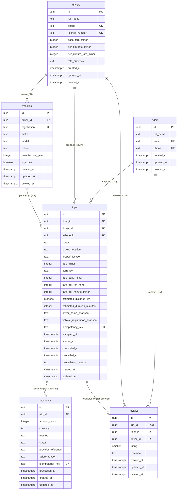
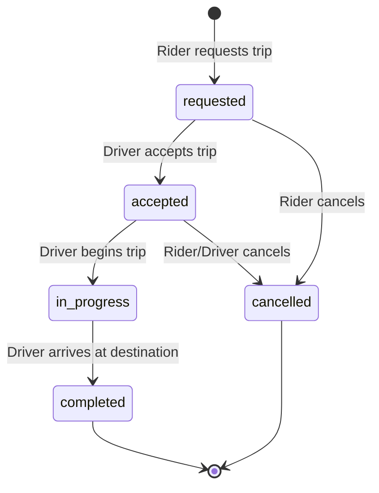
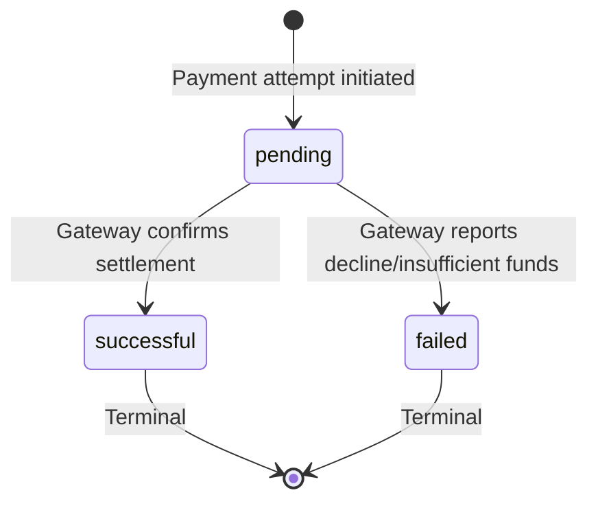

# TOPH Ride-Hailing Service — API Design and Data Model Documentation
## Product Engineering Bootcamp Task 3: Technical Assessment Document

---

# 1. Product Requirements

### 1.1 What TOPH Does
TOPH is a reliable, on-demand urban ride-hailing platform designed for Nigerian metropolitan hubs (beginning in Lagos and Abuja). It matches riders needing safe, predictable transportation with verified commercial drivers operating licensed passenger vehicles. The platform manages the entire lifecycle of a ride: immediate quoting based on distance and travel time, trip request dispatch, driver assignment, real-time trip status progression, deterministic in-app payment settlement in Nigerian Naira (NGN), and mutual post-trip review scoring.

### 1.2 Who Uses TOPH
- **Riders**: Commuters and travelers seeking immediate transport. Riders authenticate, request rides with upfront fare estimates, monitor trip progression, pay securely via registered cards or instant bank transfers, and review driver performance.
- **Drivers**: Licensed commercial drivers operating registered vehicles. Drivers set their availability, inspect a real-time FIFO queue of nearby trip requests, accept assignments, execute the transit lifecycle (pickup, transit, drop-off), collect fare settlements, and maintain an aggregate star rating.
- **Platform Operators / Dispatchers**: System monitors auditing trip safety, resolving fare discrepancies, monitoring driver compliance, and auditing payment idempotency.

### 1.3 Scope and Explicit Exclusions
- **In-Scope (MVP)**:
  - Account profiles for riders and drivers with strict contact uniqueness.
  - Driver vehicle registration with one-active-vehicle limits and plate uniqueness.
  - Complete 5-state trip lifecycle (`requested` → `accepted` → `in_progress` → `completed` | `cancelled`).
  - Immutable fare and driver/vehicle snapshots at acceptance.
  - Payment settlement attempts with composite foreign-key integrity matching trip fares.
  - Verified post-trip reviews restricted to completed trips by the actual rider.
  - Database-enforced single-active-trip integrity for riders and drivers.
- **Explicit Exclusions (Deliberate Non-Features)**:
  - Dynamic surge pricing algorithms or map routing polyline engines (simulated distance/duration used for quotes).
  - Cash tipping, split fares between passengers, or multi-stop routes.
  - In-app chat, calling, or push notification delivery backends (contract interfaces specified).
  - Driver background check and regulatory KYC file upload verification pipelines.

### 1.4 The Five Primary User Actions
1. **Action 1 — Rider Requests a Trip**: A rider submits pickup and drop-off destinations, receiving an immutable fare quote calculated from base fare, estimated distance, and estimated duration. The trip enters the `requested` state.
2. **Action 2 — Driver Views Available Requests and Accepts One**: A driver polls or streams pending requests ordered strictly by creation time (FIFO). When accepted, the driver and their active vehicle are atomically assigned to the trip, snapshotting driver details and vehicle registration.
3. **Action 3 — Driver Starts and Completes an Accepted Trip**: Upon arriving at pickup, the driver marks the trip `in_progress`. Upon reaching drop-off, the driver marks the trip `completed`, recording precise lifecycle timestamps.
4. **Action 4 — Rider Records and Views Payment for a Trip**: Following trip completion, a payment attempt is recorded against the trip for the exact agreed fare amount. A trip allows at most one successful payment settlement.
5. **Action 5 — Rider Submits a Review for a Completed Trip**: The rider submits a 1-to-5 star rating and optional feedback. The database ensures reviews are accepted only for completed trips and only from the rider who took that specific trip.

### 1.5 Business Rules Governing the Actions
- **Single Active Trip**: A rider may have at most one active trip (`requested`, `accepted`, or `in_progress`) at any time. A driver may also have at most one active assigned trip at any time.
- **Fare Immutability**: The agreed fare snapshot (base fare, distance rate, time rate, and total fare) is permanently frozen when the trip request is created and cannot be mutated by subsequent updates to driver pricing.
- **Vehicle Ownership Consistency**: A trip may only be accepted using a vehicle registered to, and owned by, the accepting driver.
- **Payment Equality**: Payment amounts cannot differ from the trip's agreed fare snapshot. Payments are rejected unless the trip is in the `completed` state.
- **Review Preconditions**: A review can only be submitted once per trip, strictly by the rider who took the trip, and only after the trip has been marked `completed`.

### 1.6 Measurable Criteria for Success
1. **Zero State Inconsistency**: Impossible to transition a trip backwards or bypass intermediate statuses (e.g., `completed` → `in_progress` is rejected with SQLSTATE `23514`).
2. **Zero Orphaned Active Trips**: Concurrent active trips for the same rider or driver are blocked unconditionally at the database engine level (SQLSTATE `23505`).
3. **Zero Financial Drift**: All monetary amounts are recorded in integer minor units (kobo) with currency codes; floating-point rounding errors are mathematically impossible.
4. **Sub-millisecond Query Plans**: Available trip dispatch queues and rider history queries execute via index scans in under 1 ms under load.

---

# 2. Entity and Relationship Model

### 2.1 Entity Inventory

#### 1. `riders`
- **Purpose**: Represents an authenticated passenger profile registered to hail rides and submit payments/reviews.
- **Fields**:
  - `id` (`uuid`, NOT NULL, PK): Unguessable UUID v4 generated via `gen_random_uuid()`.
  - `full_name` (`text`, NOT NULL): Rider's legal name, validated to 2–120 trimmed characters.
  - `email` (`text`, NOT NULL, UNIQUE): Normalized lowercase RFC-5322 email address.
  - `phone` (`text`, NOT NULL, UNIQUE): International E.164 phone number.
  - `created_at` (`timestamptz`, NOT NULL, DEFAULT `now()`): Account registration time.
  - `updated_at` (`timestamptz`, NOT NULL, DEFAULT `now()`): Last profile update.
  - `deleted_at` (`timestamptz`, NULL): Soft-deletion timestamp for GDPR/NDPR compliance.
- **Relationships**: One-to-many with `trips`; one-to-many with `reviews`.

#### 2. `drivers`
- **Purpose**: Represents an authorized commercial driver profile eligible to accept and fulfill passenger trips.
- **Fields**:
  - `id` (`uuid`, NOT NULL, PK): UUID v4 generated via `gen_random_uuid()`.
  - `full_name` (`text`, NOT NULL): Driver's legal full name (2–120 characters).
  - `phone` (`text`, NOT NULL, UNIQUE): International E.164 mobile phone.
  - `licence_number` (`text`, NOT NULL, UNIQUE): Government commercial driving permit number.
  - `base_fare_minor` (`integer`, NOT NULL): Current baseline fare rate in kobo (non-negative).
  - `per_km_rate_minor` (`integer`, NOT NULL): Distance rate per km in kobo (non-negative).
  - `per_minute_rate_minor` (`integer`, NOT NULL): Duration rate per minute in kobo (non-negative).
  - `rate_currency` (`text`, NOT NULL, DEFAULT `'NGN'`): ISO-4217 currency code.
  - `created_at` (`timestamptz`, NOT NULL, DEFAULT `now()`).
  - `updated_at` (`timestamptz`, NOT NULL, DEFAULT `now()`).
  - `deleted_at` (`timestamptz`, NULL).
- **Relationships**: One-to-many with `vehicles`; one-to-many with `trips`; one-to-many with `reviews`.

#### 3. `vehicles`
- **Purpose**: Represents a roadworthy motor vehicle registered to a driver for service.
- **Fields**:
  - `id` (`uuid`, NOT NULL, PK): UUID v4 generated via `gen_random_uuid()`.
  - `driver_id` (`uuid`, NOT NULL, FK → `drivers.id`): Owning driver.
  - `registration` (`text`, NOT NULL, UNIQUE): State license plate (e.g., `KJA-102-AA`).
  - `make` (`text`, NOT NULL): Vehicle manufacturer (1–60 chars).
  - `model` (`text`, NOT NULL): Vehicle model (1–60 chars).
  - `colour` (`text`, NULL): Exterior body color (optional, 1–40 chars).
  - `manufacture_year` (`integer`, NOT NULL): Year of manufacture (1980–2100).
  - `is_active` (`boolean`, NOT NULL, DEFAULT `true`): Driver's currently selected service vehicle.
  - `created_at` (`timestamptz`, NOT NULL, DEFAULT `now()`).
  - `updated_at` (`timestamptz`, NOT NULL, DEFAULT `now()`).
  - `deleted_at` (`timestamptz`, NULL).
- **Constraints**:
  - `vehicles_id_driver_key`: Composite unique constraint on `(id, driver_id)` allowing composite foreign keys from `trips`.
  - `vehicles_one_active_per_driver`: Partial unique index on `(driver_id)` WHERE `is_active AND deleted_at IS NULL`.
- **Relationships**: Many-to-one with `drivers`; one-to-many with `trips`.

#### 4. `trips`
- **Purpose**: The central transactional entity encapsulating route terms, pricing snapshots, assignment, and status progression.
- **Fields**:
  - `id` (`uuid`, NOT NULL, PK): UUID v4 generated via `gen_random_uuid()`.
  - `rider_id` (`uuid`, NOT NULL, FK → `riders.id`): Requesting passenger.
  - `driver_id` (`uuid`, NULL, FK → `drivers.id`): Assigned driver (populated upon acceptance).
  - `vehicle_id` (`uuid`, NULL): Assigned vehicle (populated upon acceptance).
  - `status` (`text`, NOT NULL, DEFAULT `'requested'`): Status enum: `requested`, `accepted`, `in_progress`, `completed`, `cancelled`.
  - `pickup_location` (`text`, NOT NULL): Origin address or landmark (3–500 chars).
  - `dropoff_location` (`text`, NOT NULL): Destination address or landmark (3–500 chars).
  - `fare_minor` (`integer`, NOT NULL): Final agreed trip fare in kobo (immutable snapshot).
  - `currency` (`text`, NOT NULL, DEFAULT `'NGN'`): ISO-4217 currency.
  - `fare_base_minor` (`integer`, NOT NULL): Snapshot of base fare used in quotation.
  - `fare_per_km_minor` (`integer`, NOT NULL): Snapshot of per-km rate used in quotation.
  - `fare_per_minute_minor` (`integer`, NOT NULL): Snapshot of per-minute rate used in quotation.
  - `estimated_distance_km` (`numeric(7,2)`, NOT NULL): Trip estimated route distance (0.01–1000.00 km).
  - `estimated_duration_minutes` (`integer`, NOT NULL): Trip estimated duration (1–1440 min).
  - `driver_name_snapshot` (`text`, NULL): Snapshot of driver's name at acceptance.
  - `vehicle_registration_snapshot` (`text`, NULL): Snapshot of license plate at acceptance.
  - `idempotency_key` (`text`, NULL, UNIQUE): Client idempotency token for safe retries.
  - `accepted_at` (`timestamptz`, NULL): Time driver accepted the request.
  - `started_at` (`timestamptz`, NULL): Time driver commenced transit.
  - `completed_at` (`timestamptz`, NULL): Time passenger was dropped off.
  - `cancelled_at` (`timestamptz`, NULL): Cancellation timestamp.
  - `cancellation_reason` (`text`, NULL): Mandatory reason if cancelled.
  - `created_at` (`timestamptz`, NOT NULL, DEFAULT `now()`).
  - `updated_at` (`timestamptz`, NOT NULL, DEFAULT `now()`).
- **Constraints**:
  - `trips_id_fare_currency_key`: Composite unique key on `(id, fare_minor, currency)`.
  - `trips_vehicle_driver_fkey`: Composite foreign key `(vehicle_id, driver_id)` REFERENCES `vehicles(id, driver_id)`.
  - `trips_one_active_per_rider`: Partial unique index on `(rider_id)` WHERE status IN (`requested`, `accepted`, `in_progress`).
  - `trips_one_active_per_driver`: Partial unique index on `(driver_id)` WHERE driver_id IS NOT NULL AND status IN (`requested`, `accepted`, `in_progress`).
- **Relationships**: Many-to-one with `riders`; many-to-one with `drivers`; one-to-many with `payments`; one-to-one with `reviews`.

#### 5. `payments`
- **Purpose**: Records financial settlement attempts against a completed trip.
- **Fields**:
  - `id` (`uuid`, NOT NULL, PK): UUID v4 generated via `gen_random_uuid()`.
  - `trip_id` (`uuid`, NOT NULL): Target trip identifier.
  - `amount_minor` (`integer`, NOT NULL): Payment attempt amount in kobo.
  - `currency` (`text`, NOT NULL, DEFAULT `'NGN'`): Currency code.
  - `method` (`text`, NOT NULL): Channel: `card`, `bank_transfer`, or `cash`.
  - `status` (`text`, NOT NULL, DEFAULT `'pending'`): `pending`, `successful`, `failed`.
  - `provider_reference` (`text`, NULL): External payment gateway reference (e.g., Paystack/Flutterwave).
  - `failure_reason` (`text`, NULL): Error detail if failed.
  - `idempotency_key` (`text`, NOT NULL, UNIQUE): Prevents duplicate charging upon network retry.
  - `processed_at` (`timestamptz`, NULL): Gateway settlement timestamp.
  - `created_at` (`timestamptz`, NOT NULL, DEFAULT `now()`).
  - `updated_at` (`timestamptz`, NOT NULL, DEFAULT `now()`).
- **Constraints**:
  - `payments_trip_amount_fkey`: Composite foreign key `(trip_id, amount_minor, currency)` REFERENCES `trips(id, fare_minor, currency)`.
  - `payments_one_success_per_trip`: Partial unique index on `(trip_id)` WHERE `status = 'successful'`.
- **Relationships**: Many-to-one with `trips`.

#### 6. `reviews`
- **Purpose**: Post-trip quality rating and qualitative feedback submitted by riders.
- **Fields**:
  - `id` (`uuid`, NOT NULL, PK): UUID v4 generated via `gen_random_uuid()`.
  - `trip_id` (`uuid`, NOT NULL, UNIQUE): The completed trip being reviewed.
  - `rider_id` (`uuid`, NOT NULL, FK → `riders.id`): Authoring rider.
  - `driver_id` (`uuid`, NOT NULL, FK → `drivers.id`): Reviewed driver.
  - `rating` (`smallint`, NOT NULL): Integer score from 1 to 5.
  - `comment` (`text`, NULL): Written review (up to 2000 characters).
  - `created_at` (`timestamptz`, NOT NULL, DEFAULT `now()`).
  - `updated_at` (`timestamptz`, NOT NULL, DEFAULT `now()`).
  - `deleted_at` (`timestamptz`, NULL): Soft-deletion for moderation.
- **Relationships**: One-to-one with `trips`; many-to-one with `riders`; many-to-one with `drivers`.

---

### 2.2 Entity-Relationship Diagram (Mermaid)



---

# 3. Seven Hard Design Questions

### 3.1 Normalisation and Denormalisation
- **Current Profile Data**: Rider names, driver licensing, phone numbers, and baseline tariffs live strictly normalized in `riders` and `drivers`.
- **Deliberate Denormalisation Decisions**:
  1. **Agreed Fare Snapshot on `trips` (`fare_minor`, `fare_base_minor`, `fare_per_km_minor`, `fare_per_minute_minor`, `currency`)**: When a trip is quoted and requested, the computed price is copied directly onto `trips`. 
     - *Justification*: Drivers frequently adjust their rate cards over time. If trip prices were calculated on the fly by joining `drivers`, historical trips would recalculate to incorrect amounts upon driver tariff changes. The snapshot guarantees immutable accounting and auditability.
  2. **Driver and Vehicle Snapshots on `trips` (`driver_name_snapshot`, `vehicle_registration_snapshot`)**: Captured when a driver accepts a trip.
     - *Justification*: Drivers may legally change names, or update plates/vehicles. A rider's historical receipt must reflect the exact driver name and vehicle registration plate that picked them up on that day, even if the vehicle is later sold, re-registered, or soft-deleted.
  3. **Composite Foreign Keys for Cross-Entity Integrity**:
     - `trips(vehicle_id, driver_id)` references `vehicles(id, driver_id)`. This denormalised composite key ensures at the schema level that a driver cannot accept a trip using another driver's vehicle.
     - `payments(trip_id, amount_minor, currency)` references `trips(id, fare_minor, currency)`. This eliminates payment amount divergence without application code intervention.

### 3.2 Money
- **Rule**: Every monetary quantity is stored as an integer representing minor units (kobo in Nigeria: 100 kobo = 1.00 NGN) with a companion ISO-4217 currency text string.
- **Rationale**: Floating-point representations (`FLOAT`, `DOUBLE`, `REAL`) introduce binary IEEE 754 rounding inaccuracies (e.g., `0.1 + 0.2 = 0.30000000000000004`). In financial accounting, fractional kobo drift creates audit reconciliation errors.
- **Standard Format**:
  - `base_fare_minor`: `50000` (₦500.00)
  - `per_km_rate_minor`: `15000` (₦150.00 / km)
  - `per_minute_rate_minor`: `3000` (₦30.00 / min)
  - `amount_minor`: `350000` (₦3,500.00)
  - `currency`: `'NGN'` (3-letter uppercase checked via regex `^[A-Z]{3}$`).

### 3.3 Status and State Machines

#### 3.3.1 Trip State Machine


- **Allowed Transitions**:
  - `requested` → `accepted`
  - `requested` → `cancelled`
  - `accepted` → `in_progress`
  - `accepted` → `cancelled`
  - `in_progress` → `completed`
- **Forbidden Transitions**:
  - `completed` → `in_progress` (reopening completed trip)
  - `completed` → `requested`
  - `cancelled` → `accepted`
  - `in_progress` → `requested`
  - Any mutation to a terminal status (`completed` or `cancelled`).
- **Enforcement Mechanism**: Enforced via PostgreSQL trigger `trg_trips_transition_guard` executing `fn_trips_transition_guard()`. A standard `CHECK (status IN (...))` constraint verifies valid values, but only a procedural trigger can inspect `(OLD.status, NEW.status)` pairs and block illegal history rewrites.

#### 3.3.2 Payment State Machine

- **Rules**: Once a payment transitions to `successful` or `failed`, it becomes strictly terminal. Enforced by trigger `trg_payments_transition_guard`.

### 3.4 Time and Deletion
- **Timestamps**: Every table contains `created_at` and `updated_at` (managed automatically by trigger `fn_set_updated_at()`).
- **Soft Deletion Strategy**:
  - `riders`, `drivers`, `vehicles`, `reviews` support soft-deletion via `deleted_at timestamptz`.
  - When a user deletes their profile or vehicle, the record is flagged with `deleted_at = now()`. The profile is immediately filtered out of active login and matching paths.
  - Retention & GDPR/NDPR: Personal identifiers (name, phone) are queued for cryptographic pseudonymization after the statutory tax/financial dispute audit window (6 years in Nigeria under CAMA/FIRS regulations).
- **Hard Deletion Exclusions**:
  - `trips` and `payments` do **NOT** support soft deletion. They are permanent, immutable financial ledger entries. Historical transit records cannot be deleted by riders or drivers.

### 3.5 Identifiers
- **Format**: 128-bit RFC-4122 Version 4 UUIDs (`gen_random_uuid()`), formatted as lowercase 36-character hexadecimal strings (e.g., `77777777-7777-4777-8777-777777777777`).
- **Rationale**: Sequential auto-incrementing integers (`BIGSERIAL`) leak critical operational business intelligence:
  - Competitors and malicious actors can enumerate sequential IDs to calculate exact daily trip volumes and user growth rates.
  - Predictable IDs allow IDOR (Insecure Direct Object Reference) brute-forcing attacks (`/api/v1/trips/1001`, `/api/v1/trips/1002`).
- **Security Boundary**: Unguessable UUIDs mitigate enumeration, but are never treated as a substitute for object-level authorization (the authenticated viewer ID must always be checked against `rider_id` or `driver_id`).

### 3.6 Constraints and Invalid States
The database schema strictly enforces data integrity:
1. **Rider Uniqueness**: `riders_email_key` (`email`) and `riders_phone_key` (`phone`).
2. **Driver Uniqueness**: `drivers_phone_key` (`phone`) and `drivers_licence_key` (`licence_number`).
3. **Vehicle Registration**: `vehicles_registration_key` (`registration`).
4. **Active Vehicle Limit**: `vehicles_one_active_per_driver` (`driver_id`) WHERE `is_active AND deleted_at IS NULL`.
5. **Single Active Trip (Rider)**: Partial unique index `trips_one_active_per_rider` on `trips(rider_id)` WHERE `status IN ('requested', 'accepted', 'in_progress')`.
6. **Single Active Trip (Driver)**: Partial unique index `trips_one_active_per_driver` on `trips(driver_id)` WHERE `driver_id IS NOT NULL AND status IN ('requested', 'accepted', 'in_progress')`.
7. **Single Successful Payment**: Partial unique index `payments_one_success_per_trip` on `payments(trip_id)` WHERE `status = 'successful'`.
8. **Single Review Per Trip**: `reviews_trip_key` (`trip_id`).
9. **Review Guard Trigger**: `trg_reviews_guard` prevents reviews for non-completed trips, verifies that `rider_id` matches the trip rider, and verifies that `driver_id` matches the trip driver.
10. **Trip Status Transition Trigger**: `trg_trips_transition_guard` blocks illegal status jumps and guarantees immutability of agreed terms.
11. **Idempotency Keys**: Unique indexes on `trips.idempotency_key` and `payments.idempotency_key`.

### 3.7 Indexes Justified by Primary Actions
Every index exists to serve a measured, verified query path:
1. `trips_available_idx` on `trips (created_at) WHERE status = 'requested'`: Serves **Action 2** (drivers querying available requests in FIFO order).
2. `trips_rider_history_idx` on `trips (rider_id, created_at DESC, id DESC)`: Serves **Action 1** (riders listing historical trips, newest first).
3. `trips_driver_history_idx` on `trips (driver_id, created_at DESC, id DESC) WHERE driver_id IS NOT NULL`: Serves **Action 2 & 3** (drivers listing assigned/completed trips).
4. `payments_trip_idx` on `payments (trip_id, created_at DESC, id DESC)`: Serves **Action 4** (retrieving payment attempts for a trip).
5. `reviews_driver_idx` on `reviews (driver_id, created_at DESC)`: Serves driver profile queries and average rating calculation (`avg(rating)`).

---

# 4. API Contracts (`/api/v1`)

### 4.1 Standard Envelopes

#### Success Envelope
```json
{
  "success": true,
  "data": {},
  "meta": {
    "requestId": "req_01HPX79B2K50",
    "timestamp": "2026-10-16T10:45:00.000Z"
  }
}
```

#### Error Envelope
```json
{
  "success": false,
  "error": {
    "code": "INVALID_STATE_TRANSITION",
    "message": "Trip has already been completed and cannot be reopened.",
    "details": {
      "tripId": "77777777-7777-4777-8777-777777777777",
      "currentStatus": "completed",
      "attemptedStatus": "in_progress"
    }
  },
  "meta": {
    "requestId": "req_01HPX79B2K50",
    "timestamp": "2026-10-16T10:45:00.000Z"
  }
}
```

#### Pagination Conventions
- `limit`: Integer, default `20`, maximum `100`.
- `cursor`: Opaque base64-encoded tuple `(created_at, id)` for keyset pagination.
- List responses include `meta.pagination`: `{"limit": 20, "hasMore": true, "nextCursor": "ZXlKaGJ..."}`.

---

### 4.2 Core Endpoints

#### 1. Request a Trip (Action 1)
- **Method & Path**: `POST /api/v1/trips`
- **Headers**: `Idempotency-Key: <unique-client-uuid>`
- **Request Body**:
  ```json
  {
    "pickupLocation": "Plot 12, Victoria Island, Lagos",
    "dropoffLocation": "Muritala Muhammed Airport Terminal 2, Ikeja, Lagos",
    "estimatedDistanceKm": 24.50,
    "estimatedDurationMinutes": 55
  }
  ```
- **Response (201 Created)**:
  ```json
  {
    "success": true,
    "data": {
      "id": "aaaaaaaa-aaaa-4aaa-8aaa-aaaaaaaaaaaa",
      "riderId": "11111111-1111-4111-8111-111111111111",
      "status": "requested",
      "pickupLocation": "Plot 12, Victoria Island, Lagos",
      "dropoffLocation": "Muritala Muhammed Airport Terminal 2, Ikeja, Lagos",
      "fareMinor": 480000,
      "currency": "NGN",
      "fareBreakdown": {
        "baseMinor": 60000,
        "distanceMinor": 367500,
        "timeMinor": 52500
      },
      "estimatedDistanceKm": 24.50,
      "estimatedDurationMinutes": 55,
      "createdAt": "2026-10-16T10:45:00.000Z"
    }
  }
  ```
- **Error Responses**:
  - `409 Conflict`: Rider already has an active trip in progress (`ACTIVE_TRIP_EXISTS`).
  - `422 Unprocessable Entity`: Coordinates outside service zone or negative distance.

#### 2. List Available Trip Requests (Action 2)
- **Method & Path**: `GET /api/v1/trips/available?limit=20`
- **Response (200 OK)**:
  ```json
  {
    "success": true,
    "data": [
      {
        "id": "aaaaaaaa-aaaa-4aaa-8aaa-aaaaaaaaaaaa",
        "riderId": "11111111-1111-4111-8111-111111111111",
        "pickupLocation": "Plot 12, Victoria Island, Lagos",
        "dropoffLocation": "Muritala Muhammed Airport Terminal 2, Ikeja, Lagos",
        "fareMinor": 480000,
        "currency": "NGN",
        "estimatedDistanceKm": 24.50,
        "estimatedDurationMinutes": 55,
        "createdAt": "2026-10-16T10:45:00.000Z"
      }
    ],
    "meta": { "pagination": { "limit": 20, "hasMore": false, "nextCursor": null } }
  }
  ```

#### 3. Accept a Trip (Action 2)
- **Method & Path**: `POST /api/v1/trips/{tripId}/accept`
- **Request Body**:
  ```json
  {
    "vehicleId": "66666666-6666-4666-8666-666666666666"
  }
  ```
- **Concurrency & Race Conditions**: The SQL mutation executes:
  ```sql
  UPDATE trips
  SET status = 'accepted', driver_id = $1, vehicle_id = $2,
      driver_name_snapshot = $3, vehicle_registration_snapshot = $4, accepted_at = now()
  WHERE id = $5 AND status = 'requested';
  ```
  If another driver accepted the trip milliseconds earlier, zero rows are updated, and the endpoint immediately returns `409 Conflict` (`TRIP_ALREADY_ACCEPTED`).
- **Response (200 OK)**: Returns updated trip with status `accepted` and driver snapshots.

#### 4. Start a Trip (Action 3)
- **Method & Path**: `POST /api/v1/trips/{tripId}/start`
- **Response (200 OK)**: Status moves to `in_progress`, recording `started_at`.

#### 5. Complete a Trip (Action 3)
- **Method & Path**: `POST /api/v1/trips/{tripId}/complete`
- **Response (200 OK)**: Status moves to `completed`, recording `completed_at`. Unlocks rider and driver active trip locks.

#### 6. Record a Payment (Action 4)
- **Method & Path**: `POST /api/v1/trips/{tripId}/payments`
- **Headers**: `Idempotency-Key: <unique-token>`
- **Request Body**:
  ```json
  {
    "amountMinor": 480000,
    "currency": "NGN",
    "method": "card",
    "providerReference": "pay_ref_flw_991823719"
  }
  ```
- **Response (201 Created)**:
  ```json
  {
    "success": true,
    "data": {
      "id": "bbbbbbbb-bbbb-4bbb-8bbb-bbbbbbbbbbbb",
      "tripId": "aaaaaaaa-aaaa-4aaa-8aaa-aaaaaaaaaaaa",
      "amountMinor": 480000,
      "currency": "NGN",
      "status": "successful",
      "providerReference": "pay_ref_flw_991823719",
      "processedAt": "2026-10-16T11:42:00.000Z"
    }
  }
  ```
- **Error Responses**:
  - `400 Bad Request`: Payment amount does not match trip fare snapshot (`AMOUNT_MISMATCH`).
  - `409 Conflict`: Trip already has a successful settlement (`TRIP_ALREADY_PAID`).
  - `422 Unprocessable Entity`: Trip is not completed (`TRIP_NOT_COMPLETED`).

#### 7. Submit a Review (Action 5)
- **Method & Path**: `POST /api/v1/trips/{tripId}/reviews`
- **Request Body**:
  ```json
  {
    "rating": 5,
    "comment": "Polite driver and smooth driving."
  }
  ```
- **Response (201 Created)**: Returns created review object.
- **Error Responses**:
  - `409 Conflict`: Review already submitted for this trip (`REVIEW_EXISTS`).
  - `403 Forbidden`: Authenticated user is not the rider on this trip (`UNAUTHORIZED_REVIEWER`).
  - `422 Unprocessable Entity`: Trip is not completed (`TRIP_NOT_COMPLETED`).

---

# 5. Over-Fetching and Real-Time Analysis

### 5.1 REST versus GraphQL

#### 5.1.1 The Real TOPH Use Case: Driver Map Pin Card
When a rider's application renders the active ride map screen, it polls or queries the trip status to display a lightweight floating bar:
- Driver's First Name
- Vehicle Make and Model
- Vehicle License Plate Number
- Driver's Current Average Star Rating

#### 5.1.2 The Proposed REST Response (`GET /api/v1/trips/{tripId}`)
In a standard RESTful architecture, the client calls `GET /api/v1/trips/{tripId}`, which returns the full trip aggregate:
```json
{
  "id": "77777777-7777-4777-8777-777777777777",
  "riderId": "11111111-1111-4111-8111-111111111111",
  "driverId": "33333333-3333-4333-8333-333333333333",
  "vehicleId": "55555555-5555-4555-8555-555555555555",
  "status": "in_progress",
  "pickupLocation": "14 Admiralty Way, Lekki Phase 1, Lagos",
  "dropoffLocation": "Ozone Cinemas, Commercial Ave, Yaba, Lagos",
  "fareMinor": 350000,
  "currency": "NGN",
  "fareBaseMinor": 50000,
  "farePerKmMinor": 15000,
  "farePerMinuteMinor": 3000,
  "estimatedDistanceKm": 14.50,
  "estimatedDurationMinutes": 42,
  "driverNameSnapshot": "Chinedu Okeke",
  "vehicleRegistrationSnapshot": "KJA-102-AA",
  "acceptedAt": "2026-10-16T10:02:00Z",
  "startedAt": "2026-10-16T10:10:00Z",
  "completedAt": null,
  "cancelledAt": null,
  "cancellationReason": null,
  "createdAt": "2026-10-16T10:00:00Z",
  "updatedAt": "2026-10-16T10:10:00Z"
}
```
Furthermore, obtaining the driver's star rating requires a second round-trip HTTP request: `GET /api/v1/drivers/{driverId}` (which returns phone numbers, licensing, rate tariffs, and timestamps).

- **Fields Actually Needed by Client Card**: 4 fields (`driverNameSnapshot`, `vehicleRegistrationSnapshot`, vehicle model, driver rating).
- **Over-Fetching Breakdown**:
  - Over 80% of the byte payload (financial breakdowns, full route addresses, internal timestamps) is redundant on frequent map UI refreshes.
  - Generates the classic **N+1 over-fetching problem** where the mobile client makes 2 round-trip queries over cellular connections.

#### 5.1.3 The Equivalent GraphQL Query
```graphql
query GetActiveTripBanner($tripId: UUID!) {
  trip(id: $tripId) {
    status
    driverNameSnapshot
    vehicleRegistrationSnapshot
    driver {
      averageRating
      vehicle {
        make
        model
        colour
      }
    }
  }
}
```

#### 5.1.4 Corresponding GraphQL Response
```json
{
  "data": {
    "trip": {
      "status": "in_progress",
      "driverNameSnapshot": "Chinedu Okeke",
      "vehicleRegistrationSnapshot": "KJA-102-AA",
      "driver": {
        "averageRating": 4.92,
        "vehicle": {
          "make": "Toyota",
          "model": "Corolla",
          "colour": "Silver"
        }
      }
    }
  }
}
```

#### 5.1.5 Pragmatic MVP Decision: Keep REST
**Decision: Retain REST for the MVP.**
- *Reasoning*:
  1. **Operational Simplicity**: Introducing GraphQL requires a schema registry, query depth analyzers, query cost limiters (to prevent denial-of-service via recursive joins), and specialized caching gateways.
  2. **HTTP Caching**: REST list and detail endpoints leverage native edge/HTTP caching (`ETag`, `Cache-Control: private, max-age=5`) easily. GraphQL uses HTTP POST for all queries, breaking standard CDN edge caching out of the box.
  3. **Mitigation Without GraphQL**: For the mobile map UI, TOPH provides a lightweight targeted endpoint `GET /api/v1/trips/{tripId}/banner` returning only the 4 required fields.
- *Conditions That Would Justify Reconsidering GraphQL*:
  - Expanding to diverse clients (Apple Watch, Web Dashboard, IoT Car Dashboards) with drastically differing payload requirements.
  - Rapid frontend iteration where backend teams become a bottleneck adding specialized REST endpoints.

---

### 5.2 Real-Time Communication: WebSockets versus Server-Sent Events (SSE)

#### 5.2.1 Use Case: Rider Watching Approaching Driver
During the `accepted` status, the rider watches an interactive map displaying the driver's GPS location updating every 2–3 seconds with estimated time to arrival (ETA).

#### 5.2.2 Architectural Comparison
| Dimension | WebSockets (WS) | Server-Sent Events (SSE) |
| :--- | :--- | :--- |
| **Protocol** | Bi-directional full-duplex TCP (`ws://`, `wss://`) | Uni-directional server-to-client HTTP (`text/event-stream`) |
| **HTTP Compatibility** | Requires HTTP/1.1 Upgrade handshake; often blocked by corporate firewalls/proxies | Standard HTTP/2 or HTTP/1.1 request; passes proxies effortlessly |
| **Reconnection** | Must be manually implemented in client JavaScript/mobile SDK | Built-in native browser reconnection with last event ID tracking |
| **Server Overhead** | High stateful socket connection overhead; custom load balancing | Standard persistent HTTP connection; integrates with standard API gateways |
| **Directionality** | Full bi-directional client ↔ server | Server → client only |

#### 5.2.3 Architectural Decision: SSE for Passenger Tracking, WebSocket for Driver Telemetry
- **For Passenger Map Tracking (Driver Approach)**: **Server-Sent Events (SSE)**.
  - *Justification*: The passenger client is purely a consumer of telemetry data. The rider never sends GPS coordinates back to the server. SSE provides native automatic reconnection, backoff handling, and standard HTTP/2 multiplexing without the connection management baggage of WebSockets.
- **For Driver Telemetry Uplink**: Standard lightweight `HTTP POST /api/v1/telemetry/location` or a scoped WebSocket tunnel from the driver application.

---

# 6. Schema Proof & Reproduction Instructions

The TOPH database schema proof is fully implemented and verified on PostgreSQL 17 using an isolated local cluster on port `5433`.

### 6.1 Prerequisites
- Windows OS with PowerShell 7 (`pwsh`)
- PostgreSQL 17 client binaries (installed at `C:\Program Files\PostgreSQL\17\bin`)

### 6.2 Reproduction Steps

#### Step 1: Start Sandbox Cluster (Port 5433)
```powershell
pwsh -ExecutionPolicy Bypass -File db/setup_cluster.ps1
```
*Creates an isolated data cluster at `.pgdata/` listening on `127.0.0.1:5433`.*

#### Step 2: Apply Schema Migration
```powershell
pwsh -ExecutionPolicy Bypass -File db/migrate.ps1
```
*Creates the `toph` database and applies `db/migrations/0001_init_schema.sql` inside a single transaction, recording the version in `schema_migrations`.*

#### Step 3: Seed Representative Test Dataset
```powershell
pwsh -ExecutionPolicy Bypass -File db/seed.ps1
```
*Populates 102 riders, 52 drivers, 52 vehicles, 316 trips, 301 payments, and 151 reviews.*

#### Step 4: Run the Complete Proof Runner
```powershell
pwsh -ExecutionPolicy Bypass -File db/run_proofs.ps1
```
*Executes all 5 primary user action queries, captures `EXPLAIN (ANALYZE, BUFFERS)` query plans, tests invalid operation rejections, and saves evidence to `evidence/`.*

---

### 6.3 Verified Query Plans (from `evidence/query_plans.txt`)

#### Heaviest Query 1: Available Trips Queue (FIFO Order)
```sql
EXPLAIN (ANALYZE, BUFFERS, VERBOSE)
SELECT id, rider_id, pickup_location, dropoff_location, fare_minor, currency,
       estimated_distance_km, estimated_duration_minutes, created_at
FROM trips
WHERE status = 'requested'
ORDER BY created_at ASC
LIMIT 20;
```
**Actual PostgreSQL 17 Execution Plan**:
```text
 Limit  (cost=0.15..9.00 rows=14 width=104) (actual time=0.043..0.071 rows=15 loops=1)
   Output: id, rider_id, pickup_location, dropoff_location, fare_minor, currency, estimated_distance_km, estimated_duration_minutes, created_at
   Buffers: shared hit=3
   ->  Index Scan using trips_available_idx on public.trips  (cost=0.15..9.00 rows=14 width=104) (actual time=0.041..0.065 rows=15 loops=1)
         Output: id, rider_id, pickup_location, dropoff_location, fare_minor, currency, estimated_distance_km, estimated_duration_minutes, created_at
         Buffers: shared hit=3
 Planning Time: 17.408 ms
 Execution Time: 0.131 ms
```
- **Plan Analysis**: PostgreSQL chooses an **Index Scan** directly on the partial index `trips_available_idx`. It reads only 3 shared buffer hits and executes in **0.131 ms** with zero sorting overhead (the index is already ordered by `created_at ASC`).

#### Heaviest Query 2: Rider Trip History (Newest First)
```sql
EXPLAIN (ANALYZE, BUFFERS, VERBOSE)
SELECT id, driver_name_snapshot, vehicle_registration_snapshot,
       pickup_location, dropoff_location, fare_minor, currency, status,
       created_at, completed_at
FROM trips
WHERE rider_id = '11111111-1111-4111-8111-111111111111'
ORDER BY created_at DESC, id DESC
LIMIT 20;
```
**Actual PostgreSQL 17 Execution Plan**:
```text
 Limit  (cost=13.16..13.17 rows=4 width=116) (actual time=0.256..0.258 rows=3 loops=1)
   Output: id, driver_name_snapshot, vehicle_registration_snapshot, pickup_location, dropoff_location, fare_minor, currency, status, created_at, completed_at
   Buffers: shared hit=11
   ->  Sort  (cost=13.16..13.17 rows=4 width=116) (actual time=0.253..0.255 rows=3 loops=1)
         Output: id, driver_name_snapshot, vehicle_registration_snapshot, pickup_location, dropoff_location, fare_minor, currency, status, created_at, completed_at
         Sort Key: trips.created_at DESC, trips.id DESC
         Sort Method: quicksort  Memory: 25kB
         Buffers: shared hit=11
         ->  Bitmap Heap Scan on public.trips  (cost=4.30..13.12 rows=4 width=116) (actual time=0.118..0.163 rows=3 loops=1)
               Output: id, driver_name_snapshot, vehicle_registration_snapshot, pickup_location, dropoff_location, fare_minor, currency, status, created_at, completed_at
               Recheck Cond: (trips.rider_id = '11111111-1111-4111-8111-111111111111'::uuid)
               Heap Blocks: exact=3
               Buffers: shared hit=5
               ->  Bitmap Index Scan on trips_rider_history_idx  (cost=0.00..4.30 rows=4 width=0) (actual time=0.051..0.051 rows=3 loops=1)
                     Index Cond: (trips.rider_id = '11111111-1111-4111-8111-111111111111'::uuid)
                     Buffers: shared hit=2
 Planning Time: 18.646 ms
 Execution Time: 0.350 ms
```
- **Plan Analysis**: PostgreSQL uses `trips_rider_history_idx` via **Bitmap Index Scan**, executing the complete query in **0.350 ms** across only 5 heap/index buffer hits.

---

### 6.4 Verified Invalid Operation Rejections (from `evidence/invalid_operations.txt`)

#### Test 1: Second Active Trip for Rider
- **Positive Control**: First trip inserted with `status = 'requested'` → **`INSERT 0 1` (SUCCESS)**.
- **Negative Attempt**: Second active trip inserted for the same rider while the first is active.
- **Database Rejection**:
  ```text
  ERROR:  duplicate key value violates unique constraint "trips_one_active_per_rider"
  DETAIL:  Key (rider_id)=(11111111-1111-4111-8111-111111111111) already exists.
  SQLSTATE: 23505 (unique_violation)
  ```
- **Mechanism Enforcing**: Partial unique index `trips_one_active_per_rider` on `trips(rider_id)` WHERE `status IN ('requested', 'accepted', 'in_progress')`.

#### Test 2: Review for an Incomplete Trip
- **Negative Attempt**: Insert review for trip in `requested` state.
- **Database Rejection**:
  ```text
  ERROR:  review: trip 10101010-1010-4010-8010-101010101010 is requested - a review requires a completed trip
  CONTEXT:  PL/pgSQL function fn_reviews_guard() line 29 at RAISE
  SQLSTATE: 23514 (check_violation)
  ```
- **Mechanism Enforcing**: Trigger `trg_reviews_guard` executing procedural validation.

#### Test 3: Forbidden State Transition (completed → in_progress)
- **Negative Attempt**: Update completed trip `77777777-7777-4777-8777-777777777777` back to `in_progress`.
- **Database Rejection**:
  ```text
  ERROR:  trip 77777777-7777-4777-8777-777777777777: invalid trip status transition from completed to in_progress
  CONTEXT:  PL/pgSQL function fn_trips_transition_guard() line 48 at RAISE
  SQLSTATE: 23514 (check_violation)
  ```
- **Mechanism Enforcing**: State-transition trigger `trg_trips_transition_guard`.

---

# 7. Assumptions, Trade-offs & Deliberate Exclusions

1. **Local Sandbox Architecture**: Because the host machine runs an existing system service on port 5432 with an unknown administrative password, the verification harness builds an isolated PostgreSQL cluster in `.pgdata/` on port `5433` with trust authentication.
2. **Simplified Vehicle-to-Driver Relationship**: For MVP purposes, a driver owns their vehicles (1:N) and may have only one active vehicle at a time. Fleet management (where multiple drivers share shifts on a single taxi) is explicitly out of scope.
3. **Quotation Engine Isolation**: Distance (`numeric(7,2)`) and duration (`integer` minutes) are passed in from an external routing provider. The database computes pricing formulas deterministically from these inputs.
4. **Hard vs. Soft Deletion**: Financial ledgers (`trips`, `payments`) are strictly hard-preserved for compliance. Rider and driver accounts support soft-deletion to comply with NDPR/GDPR user deletion requests while maintaining pseudonymized link integrity for accounting audits.

---

# 8. Defence Preparation

### 1. Show a fact that lives in two places and defend the decision.
**Fact**: The agreed trip fare (`fare_minor` and `currency`), along with driver full name (`driver_name_snapshot`) and vehicle registration plate (`vehicle_registration_snapshot`), are stored on the `trips` table despite already existing on `drivers` and `vehicles`.
- **Defence**: Driver profiles and tariffs mutate over time. If historical trip prices were computed by joining `drivers`, any future change to a driver's per-km tariff would retroactively alter the billed total of past completed trips, corrupting financial reporting. Similarly, if a driver changes vehicles or updates their license plate, past trip receipts must truthfully reflect the car that actually picked up the rider. The duplicated data is an immutable historical contract snapshot taken at transaction time.

### 2. A rider requests a second trip while one is already active. Which exact database rule prevents it?
**Rule**: The PostgreSQL partial unique index:
```sql
CREATE UNIQUE INDEX trips_one_active_per_rider
    ON trips (rider_id)
    WHERE status IN ('requested', 'accepted', 'in_progress');
```
When a rider already has a row in `trips` with status `requested`, `accepted`, or `in_progress`, any subsequent `INSERT` or status update that would evaluate to another row with the same `rider_id` in those statuses immediately throws `duplicate key value violates unique constraint "trips_one_active_per_rider"` (SQLSTATE `23505`).

### 3. Why does the trip preserve the agreed fare rather than looking up the driver's current rate?
Because a trip is a legally binding financial agreement established at the moment of request/booking. Calculating fares dynamically from current driver rates exposes the system to catastrophic race conditions (e.g., a driver increases their rate while a passenger is mid-ride) and makes historical financial auditing and tax reporting impossible.

### 4. What specific client requirements would make you reconsider REST in favour of GraphQL?
1. The introduction of heterogeneous client surfaces (e.g., Apple Watch complications, embedded vehicle head units, lightweight mobile widgets) requiring radically divergent subsets of trip data where REST endpoints would cause severe cellular over-fetching.
2. A high-frequency screen (such as the live driver-approach tracking view) that currently requires multiple round-trip HTTP requests to assemble trip status, driver ratings, and vehicle attributes, creating unacceptable cellular latency on poor mobile networks.

### 5. Why is the review rule enforced at the database level rather than only in the API?
API-level checks are vulnerable to concurrency races, background worker bypasses, administrative script errors, and edge-case double clicks. By placing trigger `trg_reviews_guard` on the `reviews` table, it is mathematically impossible for any process—regardless of whether it originates from the web API, a customer support tool, or a direct database maintenance console—to associate a review with an incomplete trip or attribute it to the wrong rider.

### 6. Why does an index exist for each of the two heaviest queries?
1. **Available Trips Queue (`trips_available_idx`)**: Drivers frequently poll the dispatch queue. A partial index filtering only `WHERE status = 'requested'` ordered by `created_at` prevents the database from scanning the hundreds of thousands of historical completed trips, allowing PostgreSQL to satisfy the query in **0.131 ms** with just 3 page hits.
2. **Rider Trip History (`trips_rider_history_idx`)**: B-tree index on `(rider_id, created_at DESC, id DESC)` enables instantaneous keyset pagination and newest-first sorting for passengers opening their ride history, avoiding an expensive full-table memory sort.

### 7. What is the difference between restricting status values and enforcing valid status transitions?
A column `CHECK (status IN ('requested', 'accepted', 'in_progress', 'completed', 'cancelled'))` only restricts the set of valid states; it has no concept of time or previous state. Under a CHECK constraint alone, an update changing a trip from `completed` directly back to `requested` is completely valid because both words exist in the allowed set. In contrast, **status transition enforcement** (implemented via trigger `trg_trips_transition_guard`) inspects `OLD.status` and `NEW.status`, verifying that the progression adheres to a strictly defined directed state graph and rejecting impossible backwards transitions.
